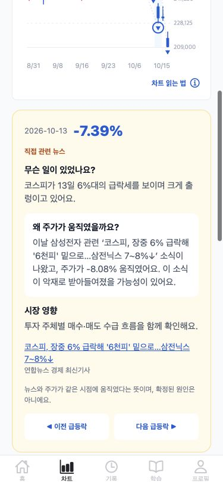

# FinSight 앱 화면·AI 기능 감사 — 2026-10-15

**1단계 점검 보고서입니다. 코드 수정과 2단계 작업은 시작하지 않았습니다.**

375×812와 1440×900의 Expo web에서 데모 계정으로 직접 클릭했습니다. 가장 먼저 고칠 문제는 **판단 상세 새로고침 시 빈 화면**, **차트와 도슨트의 등락률 불일치**, **잘못 수집된 기사 본문을 근거로 사용하는 코칭**, **퀴즈와 관계없는 개념 숙련도 갱신**입니다. 실제 Gemini 코칭은 현재 꺼져 있습니다. 재작성 기능만 LLM 사용 설정이고, 화면에서 확인한 다른 설명은 규칙·사전·발췌 기반입니다.

## 점검 조건과 증거 읽는 법

- 대상: `http://localhost:8081`, backend 8080, AI 8001. 2026-10-15 약 12:20~12:52 KST 점검.
- 계정: `finsight-demo@finsight.test`, user 31, LOCAL. 비밀번호·토큰은 보고서나 증거에 저장하지 않았습니다. **user 8/카카오 계정에는 접근하지 않았습니다.**
- 기존 데모 계정이 있어 seed를 실행하지 않았습니다. 직접 SQL 쓰기, 재채점·즉시 채점 API, 서버 재시작, 설정 변경, 유료 LLM 호출을 하지 않았습니다.
- 승인된 데모 UI 저장만 수행했습니다. 판단 2건, 퀴즈 1건, 읽기 기록, 읽기 수준 변경/원복 내역은 아래에 따로 기록했습니다. 종료 시 데모 계정에서 로그아웃했습니다.
- 기존 소스·설정 377개 파일의 SHA256은 점검 전후 모두 같습니다. 기존 작업 중인 수정도 그대로 보존했습니다. 생성물은 이 보고서와 `docs/qa-evidence-2026-10-15/`입니다. [무변경 확인](qa-evidence-2026-10-15/audit-integrity.json)
- AI health 전후 `processCalls=0`, `rewriteProcessCalls=0`, 당일 `rewriteUsedCalls=0`입니다. [전](qa-evidence-2026-10-15/ai-health-before.json) / [후](qa-evidence-2026-10-15/ai-health-after.json)
- 서버는 이전 실행 때부터 뉴스 자동 수집과 시작 시 피드백 처리가 꺼진 상태였습니다. 이번 QA가 바꾸지 않았습니다. 이는 최신 기사 부족을 해석할 때 고려할 환경 조건입니다.
- **UI 재현**: 실제 클릭·렌더링·스크린샷으로 확인. **API 재현**: 실제 로컬 API 응답으로 확인했지만 해당 결과를 DB에 저장하거나 실제 판단 상세에서 확인하지는 않음. **코드/DB 확인**: 읽기 전용 근거이며 파괴적인 동작은 실행하지 않음.
- 아래 `F/`, `B/`, `A/`는 각각 `/Users/subin/Desktop/Finsight/finsight-frontend/`, `finsight-backend/`, `finsight-ai/`입니다. 줄 번호는 현재 로컬 파일 기준입니다.

## 1. 우선순위 상위 10개

치명 등급으로 확인된 문제는 없습니다. 아래 1~7은 높음, 8~10은 보통입니다. API만으로 재현한 문제와 조건부 문제를 UI 문제로 과장하지 않았습니다.

| 번호 | 심각도 | 문제와 사용자 영향 | 확인 수준 |
|---|---|---|---|
| 1 | 높음 | 판단 상세 새로고침/주소 재진입에서 전체 화면이 비어 기록을 볼 수 없음 | UI, 두 폭 |
| 2 | 높음 | 동일 급락일의 차트는 **-7.39%**, 도슨트는 **-8.08%**라고 설명 | UI·API, 두 폭 |
| 3 | 높음 | AI 반도체주 기사 제목에 미국 국채금리 기사 본문이 붙어 잘못된 복습 근거 제공 | UI·저장 데이터, 두 폭 |
| 4 | 높음 | 일반 기사 사실 퀴즈 정답으로 **국채금리** 숙련도가 올라감 | UI 제출·DB 읽기 확인 |
| 5 | 높음 | “뉴스가 나온 뒤 다음 거래일”이라고 묻지만 오늘 남긴 판단의 다음 거래일을 채점 | UI·코드, 두 폭 |
| 6 | 높음 | 하락 근거로 상승을 골라도 “근거는 타당했다”는 평가가 남음 | 실제 RULE API; 화면 저장 안 함 |
| 7 | 높음 | 상승 기사에 NEGATIVE, 급락 기사에 NEUTRAL을 주는 시장 영향 규칙 | 실제 독립 API; 앱 직접 연결은 미확인 |
| 8 | 보통 | “오늘의 핵심 뉴스” 첫 카드가 14일 전 기사이고 요약에 사진 설명이 섞임 | UI·API |
| 9 | 보통 | 지수 차트 API는 400, 판단 상세는 6자리 종목만 조회하여 지수의 두 점 직선 문제가 남는 구조 | API·코드 확인; 해당 데모 기록 없어 UI 미재현 |
| 10 | 보통 | 퀴즈 후 `term_mastery` 때문에 데모 cleanup/회원 탈퇴가 실패할 것으로 예상 | 코드·실제 FK 확인; 삭제 미실행 |

추가 화면 문제는 11~13에 기록했습니다. 한도를 올리거나 모든 기능을 일괄 LLM으로 전환하는 것은 이 문제들의 우선 해결책이 아닙니다.

## 2. 화면별 이슈와 재현 절차

### 1) 판단 상세 주소 새로고침이 앱을 비움

- **화면 / 심각도:** 기록 → 판단 기록 상세 / 높음.
- **재현:** user 31의 판단 34를 목록에서 열기 → 주소 `history/detail?item=%5Bobject%20Object%5D` 확인 → 브라우저 새로고침.
- **기대:** 판단 ID를 이용해 서버에서 기록을 다시 읽거나 복구 가능한 오류 화면 제공.
- **실제:** 빈 화면. `Cannot read properties of undefined (reading 'length')`가 발생했습니다. 375px와 데스크톱에서 확인했습니다.
- **스크린샷:** [모바일](qa-evidence-2026-10-15/36-detail-reload-error-mobile.jpg), [데스크톱](qa-evidence-2026-10-15/35-detail-reload-error-desktop.jpg). [브라우저 오류](qa-evidence-2026-10-15/detail-reload-browser-errors.json)
- **원인:** `F/App.tsx:132`, `F/src/navigation/types.ts:26`이 상세 항목 객체 전체를 경로 인자로 사용합니다. `F/src/screens/history/JudgementDetailScreen.tsx:20`에서 이를 객체로 가정하고 `:108`에서 `item.reasons.length`를 읽습니다.

### 2) 도슨트 캐시의 수치가 현재 차트와 다름

- **화면 / 심각도:** 차트 → 삼성전자 → 2026-10-13 급등락 / 높음.
- **재현:** 삼성전자 일봉 → 10/13 급락 마커 선택 → 노란 도슨트의 등락률과 본문 비교.
- **기대:** 같은 날짜와 기준의 종가에서 계산된 하나의 수치 사용.
- **실제:** 마커/선택 카드 **-7.39%**, 본문 “주가가 **-8.08%** 움직였어요”. API의 10/12 250,500 → 10/13 232,000은 약 -7.39%입니다. 장중 가격이 변해서 생긴 비교가 아니라 **같은 과거 날짜 안의 모순**입니다. 응답 `mode=RULE`.
- **스크린샷:** [모바일](qa-evidence-2026-10-15/47-docent-mismatch-visible-mobile.jpg), [데스크톱](qa-evidence-2026-10-15/45-docent-number-mismatch-desktop.jpg). [실제 차트 응답](qa-evidence-2026-10-15/chart-005930-D.json)
- **원인 추정:** `B/src/main/java/com/finsight/chart/ChartDocentService.java:10`과 `A/app/routers/chart.py:142`의 캐시 키에 종가·변동률·지수·기사 내용이 없습니다. AI 라우터 `:149`는 기존 결과를 반환하고, Java 검사는 관계/뉴스 ID/빈 값 위주여서 수치 차이를 막지 못합니다. 캐시 생성 당시 입력을 별도로 남기지 않아 -8.08의 정확한 유입 시점은 확정할 수 없습니다.



### 3) 제목과 다른 본문을 코칭 근거로 인용

- **화면 / 심각도:** 기록 27의 복습 → 원문 / 높음.
- **재현:** 기존 데모 판단 27 → `“AI반도체주 아직도 싸다?”…` 기사(news 230)의 “기사에서 볼 근거” 확인 → 원문 열기.
- **기대:** 해당 제목의 본문만 근거로 인용. 본문 신뢰성이 부족하면 코칭을 제한.
- **실제:** “영상 모듈 닫기 미국 국채금리가 수십 년 만의 높은 수준으로…”가 본문과 복습 근거에 나옵니다. 반도체주 기사와 다른 국채 기사 내용이어서 인과 설명의 출발점이 잘못됐습니다. 해당 데모 판단의 결과 자체도 seed의 가상 결과이며 실제 투자 성과로 해석할 수 없습니다.
- **스크린샷:** [복습 모바일](qa-evidence-2026-10-15/41-review-body-contamination-mobile.jpg), [복습 데스크톱](qa-evidence-2026-10-15/40-review-body-contamination-desktop.jpg), [원문](qa-evidence-2026-10-15/42-news-contaminated-source-mobile.jpg). [응답](qa-evidence-2026-10-15/news-230.json)
- **원인 추정:** `B/src/main/java/com/finsight/news/collect/ArticleContentExtractor.java:50`, `:82`, `:159`, `:188`의 추출·정제·usable 판정으로 오염 본문이 통과한 상태입니다. `B/src/main/java/com/finsight/judgement/JudgementFeedbackRules.java:165`는 저장 본문 첫 문장을 복습 인용으로 사용합니다. 과거 저장 데이터가 이미 오염되어 정제 함수 개선만으로 모두 복구되지는 않습니다.

### 4) 기사 사실 퀴즈가 엉뚱한 개념 숙련도를 올림

- **화면 / 심각도:** 뉴스 178 → 쉽게읽기 → 분석용 퀴즈 / 높음.
- **재현:** “다음 중 기사에 나온 사실이 아닌 것은?”에서 “다음 거래일의 주가 상승이 확정됐다고 밝혔다”를 선택.
- **기대:** 기사 독해 실력에 대한 피드백. 국채금리를 평가하려면 그 개념을 묻는 문항이어야 함.
- **실제:** 정답 뒤 국채금리 정의가 표시되고 `learning_progress 331, term=국채금리, level=analyst, correct=true`로 저장됐습니다. `term_mastery`도 attempts=1, p_known≈0.6416으로 생겼습니다. 이 문항을 맞혔다는 사실이 국채금리 이해를 검증하지는 않습니다.
- **스크린샷:** [모바일 문항](qa-evidence-2026-10-15/19-news-analyst-mobile.jpg), [데스크톱 문항](qa-evidence-2026-10-15/20-news-analyst-desktop.jpg), [제출 결과](qa-evidence-2026-10-15/21-quiz-answered-desktop.jpg). [본인 데모 저장 확인](qa-evidence-2026-10-15/demo-state-after.json)
- **원인:** `B/src/main/java/com/finsight/learning/LearningService.java:199–211`에서 기사 전체 사실 문항에도 선택된 term을 부여합니다. `:104–106`은 그 term의 숙련도를 갱신합니다. 보기의 “수익 보장/변동 없음/상승 확정”도 반복되므로 기사 대신 표현만 보고 풀기 쉽습니다.

### 5) 판단 질문의 기준 시점과 채점 시점 불일치

- **화면 / 심각도:** 판단하기 → 제출 완료 / 높음.
- **재현:** 10/15에 10/1 발행 news 178로 판단하기 → 질문과 완료 예정일 비교.
- **기대:** “지금 남기는 판단의 기준일 → 다음 거래일”과 실제 비교일 명시.
- **실제:** 질문은 “이 뉴스가 나온 뒤 다음 거래일 코스닥는?”인데 제출 안내는 **10/16 장 마감 후**입니다. 사용자는 10/2를 묻는 것으로 읽을 수 있습니다. 조사 “코스닥는”도 어색합니다.
- **스크린샷:** [질문 모바일](qa-evidence-2026-10-15/26-judgement-mobile.jpg), [질문 데스크톱](qa-evidence-2026-10-15/25-judgement-desktop.jpg), [예정일 모바일](qa-evidence-2026-10-15/27-judgement-submitted-mobile.jpg), [예정일 데스크톱](qa-evidence-2026-10-15/28-judgement-submitted-desktop.jpg).
- **원인:** `F/src/screens/home/JudgementScreen/index.tsx:78`의 문구는 기사 시점, backend의 예상일·채점은 판단 생성 시점 기준입니다. 근거 수정 후 판단 34의 `created_at`도 수정 시각으로 갱신되어 있습니다. 기준일 정책 변경이 아니라 문구·일자 표시부터 맞추는 것이 안전합니다.

### 6) 방향 모순을 놓쳐 잘못 칭찬하는 근거 평가

- **화면 / 심각도:** 판단 코칭 엔진 / 높음. **API 재현이며 실제 판단 저장은 하지 않았습니다.**
- **재현:** 실제 news 324와 실제 10/12→10/13 종가로 `/ai/feedback/judgement` 호출. 근거는 “기사에서 반도체 약세를 확인했고 이익 기대 악화가 매도 수급으로 이어질 수 있다고 봤어요.”, 선택 UP, 결과 DOWN.
- **기대:** 하락을 가리키는 근거와 상승 선택의 모순 안내. 과정이 탄탄하다는 평가는 피함.
- **실제:** WRONG이지만 “근거는 타당했지만 기사 신호와 다른 방향 선택으로 빗나갔을 수 있어 좋은 근거도 틀릴 수 있어요.”가 나옵니다. 동일 근거로 DOWN을 선택하면 CORRECT와 “판단 과정도 탄탄했어요”가 나옵니다.
- **증거 / 스크린샷 경로:** UI 경로로 저장하지 않아 스크린샷 없음. [실제 요청·응답 JSON의 feedback-UP / feedback-DOWN](qa-evidence-2026-10-15/ai-feature-api-examples.json).
- **원인:** `A/app/services/llm_client.py:819–837`, `B/src/main/java/com/finsight/judgement/JudgementFeedbackRules.java:23–41`. 긍정 단어 “기대”와 부정 단어 “악화/약세”가 함께 있으면 NEUTRAL이 되고 contradicts=false가 됩니다. “기대 악화”를 하나의 부정 표현으로 처리하지 못합니다.

### 7) 시장 영향 규칙의 방향과 인용 근거가 반대

- **화면 / 심각도:** 독립 시장 영향 API / 높음. **현재 Java·프론트에서 이 endpoint를 직접 호출하는 경로는 찾지 못했습니다. 화면 배지의 원인이라고 단정하지 않습니다.**
- **재현:** 저장된 news 178과 news 340의 제목·본문을 `/ai/news/impact`에 보냄.
- **기대:** 현재 기사 핵심과 일치하는 방향, 혼합 신호라면 그 이유를 설명. confidence는 검증된 확률로 오해되지 않아야 함.
- **실제:** 상승 전환 기사 178 → `NEGATIVE, confidence=0.7`인데 evidence에는 “상승…마감했다”가 들어갑니다. 코스피 급락 기사 340 → `NEUTRAL, confidence=0.3`입니다.
- **증거 / 스크린샷 경로:** 직접 연결된 UI 없음. [impact-178 / impact-340 실제 응답](qa-evidence-2026-10-15/ai-feature-api-examples.json).
- **원인 추정:** `A/app/services/llm_client.py:259–293`은 본문 전체 키워드 및 `_topic_direction`을 이용합니다. 과거·당일·전망·반전과 주체를 구분하지 못하고, direction을 정한 규칙과 evidence를 고르는 기준도 다릅니다.

### 8) 오늘의 뉴스가 오래된 기사와 사진 설명을 우선 노출

- **화면 / 심각도:** 홈 뉴스 카드 / 보통.
- **재현:** 10/15 홈 → “오늘의 핵심 뉴스” 첫 카드와 날짜·요약 확인.
- **기대:** 최신 수집 시점 안내, 최신 기사 우선 또는 “최근 수집 뉴스”처럼 정확한 제목. 기사 사실 요약.
- **실제:** 첫 카드 news 178은 10/1 발행(14일 전)이며 더 최근인 10/13~14 기사도 저장돼 있습니다. 일부 카드 요약에 사진 설명이 남습니다.
- **스크린샷:** [모바일](qa-evidence-2026-10-15/12-home-mobile.jpg), [데스크톱](qa-evidence-2026-10-15/13-home-desktop.jpg), [더 보기](qa-evidence-2026-10-15/14-home-more-desktop.jpg).
- **원인:** `B/src/main/java/com/finsight/briefing/BriefingService.java:58–78`은 오늘 기사가 없으면 오래된 기사도 관련도 순으로 올릴 수 있습니다. `:89–96`은 저장된 normal 요약을 사용합니다. 현재 뉴스 수집 disabled는 환경 조건이지만 오래된 기사를 “오늘”로 보이게 하는 UX는 별도 문제입니다.

### 9) 지수 판단의 두 점 직선 — 조건부 확인

- **화면 / 심각도:** 지수 대상 판단 상세 / 보통. **데모에 유효한 지수 채점 완료 기록이 없어 해당 직선의 실제 화면은 재현하지 못했습니다.**
- **재현 조건:** target_symbol=KOSPI/KOSDAQ이고 유효한 comparison_date·두 종가가 있는 판단 상세.
- **기대:** 충분한 일봉을 받거나 두 가격을 비교 카드로 명시.
- **실제 확인:** `GET /api/charts/KOSPI`, `/KOSDAQ`는 각각 HTTP 400입니다. 상세의 chartQuery는 6자리 종목코드에만 켜지고, 저장된 종가 두 점이 있으면 MiniLineChart에 전달하는 경로가 남아 있습니다.
- **증거 / 스크린샷 경로:** 해당 상태의 UI 캡처 없음. [API baseline](qa-evidence-2026-10-15/api-baseline.json). 기존 데모 27~29는 synthetic/legacy·대상 불일치 등의 이유로 정상 지수 채점 사례로 사용할 수 없습니다.
- **원인:** `F/src/screens/history/JudgementDetailScreen.tsx:42–45`, `:79`, `:150`; `B/src/main/java/com/finsight/chart/ChartController.java:34`. 다만 `B/src/main/java/com/finsight/external/kis/KisDailyCandleClient.java:72–89`에는 KOSPI/KOSDAQ 일봉 분기 자체가 있습니다. **저수준 조회 지원과 공개 차트 API 지원은 다릅니다.** 이번 QA에서는 추가 KIS 지수 조회를 강제로 수행하지 않았습니다.

### 10) 퀴즈 후 데모 정리와 회원 탈퇴의 삭제 의존성 누락

- **화면 / 심각도:** 프로필 회원 탈퇴 / 데모 cleanup / 보통. **삭제 실행 없이 코드·실제 FK로 확인한 실패 위험입니다.**
- **재현 조건:** user 31처럼 term_mastery가 존재하는 계정의 최종 삭제 또는 cleanup 실행.
- **기대:** 그 계정의 모든 종속 학습 자료를 트랜잭션으로 삭제하고 다른 계정은 보존.
- **실제 근거:** 실제 FK는 `term_mastery.user_id → app_user.id`이며 ON DELETE CASCADE가 없습니다. cleanup과 AuthService.deleteAccount 모두 term_mastery를 삭제하지 않습니다. 현재 상태에서 실행하면 app_user 삭제가 FK에 막힐 것으로 예상됩니다. SQL 트랜잭션은 롤백되는 구조입니다.
- **스크린샷:** 최종 확인까지만 열고 취소했습니다. [모바일](qa-evidence-2026-10-15/76-profile-delete-final-mobile.jpg), [데스크톱](qa-evidence-2026-10-15/77-profile-delete-final-desktop.jpg). [실제 FK·데모 자료](qa-evidence-2026-10-15/demo-state-after.json)
- **원인:** `B/scripts/seed_demo.py:130–135`, `B/src/main/java/com/finsight/auth/AuthService.java:34–38`. 둘 다 LearningProgress/ArticleNote/DailyNote/Judgement만 먼저 지웁니다.

### 11) 기사 문맥 없는 용어 팝업이 빈 제목 두 개를 표시

- **화면 / 심각도:** 학습 → 뉴스 읽는 법 가이드 → 수출 / 보통.
- **재현:** 가이드의 수출 용어 열기.
- **기대:** 사전 정의만 표시하거나 기사 문맥이 없다는 안내.
- **실제:** 뜻은 있으나 “이 뉴스에서는”, “시장 영향”은 내용 없이 제목만 나옵니다. API contextExplanation/marketImpact는 null입니다. 닫기와 가이드 복귀는 정상입니다.
- **스크린샷:** [모바일](qa-evidence-2026-10-15/60-guide-term-empty-sections-mobile.jpg), [데스크톱](qa-evidence-2026-10-15/59-guide-term-empty-sections-desktop.jpg).
- **원인:** `F/src/components/TermPopup.tsx:36–37` 무조건 렌더링. `B/src/main/java/com/finsight/term/TermService.java:36`은 newsId가 없으면 사전 응답을 반환합니다. LLM을 켜도 이 UI 조건은 해결되지 않습니다.

### 12) 직접 연 뉴스 오류 화면의 돌아가기가 동작하지 않음

- **화면 / 심각도:** 뉴스 상세 404 / 보통.
- **재현:** 새 문서 경로 `/news/999999999` 직접 열기 → “다시 시도” → “돌아가기”.
- **기대:** 오류가 계속되면 홈 등 유효한 화면으로 복귀 가능.
- **실제:** 404 안내와 재시도는 표시됩니다. 그러나 돌아가기를 눌러도 현재 오류 화면과 URL이 그대로입니다. 직접 진입한 navigator에 이전 화면이 없기 때문입니다.
- **스크린샷:** [모바일](qa-evidence-2026-10-15/74-news-not-found-mobile.jpg), [데스크톱](qa-evidence-2026-10-15/73-news-not-found-desktop.jpg). [DOM](qa-evidence-2026-10-15/news-not-found-error.txt)
- **원인:** `F/src/screens/home/NewsDetailScreen/index.tsx:88`의 조건 없는 `navigation.goBack()`. 일반 진입의 뒤로가기와 구분해야 합니다.

### 13) 원문 탭이 발췌임을 알리기 부족하고 퀴즈 범위와 다름

- **화면 / 심각도:** 뉴스 원문 / 분석용 퀴즈 / 보통.
- **재현:** 긴 기사 178·324의 원문과 분석용 문항을 비교.
- **기대:** 앱 본문이 발췌라는 표시, 보이는 내용으로 풀 수 있는 퀴즈 또는 필요한 근거 별도 제공.
- **실제:** “원문” 탭 본문은 말줄임표로 끝나는 약 600자 발췌입니다. 분석용 문항 생성은 저장된 전체 본문에서 사실을 뽑습니다. 앱에서 못 본 사실이 보기로 나올 수 있습니다. 외부 “원문 보기” 링크는 있습니다.
- **스크린샷:** [원문 모바일](qa-evidence-2026-10-15/16-news-detail-mobile.jpg), [원문 데스크톱](qa-evidence-2026-10-15/15-news-detail-desktop.jpg), [분석용](qa-evidence-2026-10-15/20-news-analyst-desktop.jpg).
- **원인:** `B/src/main/java/com/finsight/news/NewsDetailResponse.java:42–45`, `:59–65`는 raw/각 수준을 excerpt 처리하고, `LearningService.java:199–211`은 전체 저장 본문에서 문항을 만듭니다. 원문 전체 복제보다 발췌 표시와 출제 범위 정합성을 먼저 맞추는 편이 적절합니다.

### 화면 QA 수행표와 확인하지 못한 범위

“확인”은 아래 적은 동작 범위입니다. 모든 백엔드 장애를 인위적으로 만들거나 모든 조합의 문구를 통과시켰다는 뜻은 아닙니다.

| 화면 | 실제로 클릭·확인한 동작 | 375px / 데스크톱 | 미확인·제한 |
|---|---|---|---|
| 온보딩 | 시작, 질문 선택, 다음/이전, 선택 유지, 기존 계정 로그인 이동. 프로필 학습 설정 5개 질문을 끝까지 이동하고 저장 전 닫기 | 둘 다 | 신규 가입·최종 온보딩 저장은 하지 않음 |
| 로그인 | 빈 입력 검증, 로그인/가입 전환, 이용약관/개인정보, 비밀번호 찾기 안내, 데모 로그인 | 둘 다 | 카카오/실계정 미접근. 비밀번호 변경 안 함 |
| 홈 | 시장 패널, 뉴스 선택, 더 보기와 로딩 후 추가 카드 | 둘 다 | 시장 서버 장애를 만들지 않아 오류 재시도는 코드 확인만 |
| 뉴스 | 원문/쉽게읽기, 초보/일반/분석, 용어 밑줄·팝업·닫기, 퀴즈, 판단 진입, 관련 기사 | 둘 다 | 외부 원문 사이트 전체 QA는 범위 밖. 뉴스 404 재시도는 실제 확인 |
| 판단 | 상승/중립/하락 라디오, 근거 입력, 제출, 다시 열어 선택·근거 유지, 수정, 빈 근거 제출 | 둘 다 | 서버 강제 장애/중복 제출 경합 미주입 |
| 기록 | 목록, 주간 날짜 필터/해제, 미래 날짜 비활성, 빈 상태, 판단/메모 탭, 이전 메모 더 보기 | 둘 다 | 다음 페이지 오류는 만들지 않음 |
| 상세: 대기 | 실제 새 판단 34·35, 근거 있음/없음, 예정 비교일, 뒤로가기, 새로고침 오류 | 둘 다 | 만기 전이라 정상 대기임 |
| 상세: 복습 | 기존 가상 판단 27 등, 기사 설명/원문 이동, 빈 본문 안내 | 둘 다 | 실제 가격 적중 사례로 제시하지 않음 |
| 상세: 채점 완료/지연/도착 배지 | 데이터·코드 점검만 | **UI 미검증** | 본인 데모에 유효 comparison_date를 가진 결과/지연 기록 없음. 강제 SQL·타 계정·즉시 채점 금지로 생성하지 않음 |
| 차트 | 검색 일치/없음, 카카오 검색 결과, 인기 종목, 일봉/주봉/분봉(1·5·15), 급등락 선택/이전/다음, 가이드, 도슨트 기사 링크 | 둘 다 | 1분봉 전환 중 시세 연결 오류와 재시도 버튼은 관찰. 고의 네트워크 차단 안 함 |
| 학습 | 추천 기사 실제 열기, 팁, 퀴즈 수 안내, 개념/미완료 빈 상태, 가이드/관련 용어/닫기 | 둘 다 | 마스터리 승급 등 많은 답안을 요구하는 상태 미생성 |
| 프로필 | 수준 normal→beginner→analyst→normal 원복, 학습 설정 이동/취소, 로그아웃 취소/확인, 탈퇴 2단계 확인/취소 | 둘 다 | 최종 탈퇴 미실행. 알림은 “준비 중” 비활성 |

추가 관찰:

- 사용자 근거 없는 대기 상세의 “남긴 판단 근거가 없어요.”는 한 번만 나왔습니다. [모바일](qa-evidence-2026-10-15/67-no-reason-pending-mobile.jpg) / [데스크톱](qa-evidence-2026-10-15/68-no-reason-pending-desktop.jpg). 코칭이 있는 채점 완료 상태의 중복 제거는 데모 자료 부족으로 UI 검증하지 못했습니다.
- 방문한 복습·대기 화면에서 요청했던 “다음엔 이렇게” 카드가 재등장하지 않았습니다. 정상 채점 화면의 모든 과거 문구까지 검증한 것은 아닙니다.
- 저장 재작성 기사 411의 375px DOM에서 화면 오른쪽을 벗어나는 본문 텍스트가 없었습니다. 주요 캡처에서도 본문 잘림을 새로 확정하지 못했습니다. 가로 스크롤 칩·명시적인 카드 말줄임은 잘림 버그로 세지 않았습니다. 빈 팝업 제목 문제는 11번입니다.
- 비밀번호 찾기는 현재 “준비 중/지원하지 않음” 안내이며 실제 재설정은 제공하지 않습니다([02](qa-evidence-2026-10-15/02-password-reset-unavailable-mobile.jpg)). IPv6 `[::1]:8081`의 로그인 연결 오류는 localhost로 접속하면 해결됐습니다([08](qa-evidence-2026-10-15/08-ipv6-login-network-error.jpg)). 로컬 개발 호스트 호환성 제한으로 기록하며 전체 로그인 장애로 분류하지 않았습니다.
- 정상 링크 확인 증거: [추천 기사 모바일](qa-evidence-2026-10-15/79-recommendation-open-mobile.jpg), [데스크톱](qa-evidence-2026-10-15/78-recommendation-open-desktop.jpg), [도슨트 기사 모바일](qa-evidence-2026-10-15/80-chart-related-news-mobile.jpg), [데스크톱](qa-evidence-2026-10-15/81-chart-related-news-desktop.jpg), [메모 확장 모바일](qa-evidence-2026-10-15/83-history-notes-expanded-mobile.jpg), [데스크톱](qa-evidence-2026-10-15/82-history-notes-expanded-desktop.jpg).

## 3. AI 기능 현황과 실제 출력

### 현재 설정과 호출 경로

실행 health·설정·라우터·실제 응답을 함께 확인했습니다. `REWRITE_WITH_LLM=true`, provider는 Gemini, `USE_REAL_LLM=false`, `DOCENT_WITH_LLM=false`, `FEEDBACK_WITH_LLM`은 미설정 기본 false입니다. 유료 임베딩은 꺼져 있고 로컬 sentiment/news-index 모델도 미설정입니다. **화면의 “AI” 명칭만으로 LLM 호출을 뜻하지 않습니다.**

실제 API 응답 예시의 원본은 [ai-feature-api-examples.json](qa-evidence-2026-10-15/ai-feature-api-examples.json)입니다. 공개 기사와 main 데모의 자료만 썼습니다. 두 판단 API 예시는 실제 공개 종가에 선택을 달리 넣은 진단 요청이며 실제 저장 판단의 성공/실패 사례로 둔갑시키지 않았습니다.

| 기능 / endpoint | 화면과 연결 | 현재 모드 / 켜는 설정 | 실제 출력 예시 2개 | 템플릿처럼 느껴지는 점 |
|---|---|---|---|---|
| 판단 코칭 `POST /ai/feedback/judgement` (`routers/feedback.py`) | backend 채점 → 판단 상세. UNKNOWN 복습은 Java articleReview로 별도 생성 | **RULE**. `FEEDBACK_WITH_LLM=true` 또는 넓은 스위치 `USE_REAL_LLM`; 전자는 다른 기능을 켜지 않음 | ① DOWN 정답: “기사의 악재 신호대로 실제 하락 방향도 같았어요.” ② UP 오답: “기사의 악재 신호와 다른 방향을 골라…빗나갔을 수 있어요.” 둘 다 실제 news 324, -7.39% | 인용 뒤 분기 문장, 정형 칭찬, 일반 팁. 상세한 기업·수급 경로가 부족. 기사/결과 근거가 부족하면 과도하게 타당하다고 할 위험(6번) |
| 차트 도슨트 `POST /ai/chart/docent` (`chart.py`) | `/api/charts/005930` → 급등락 노란 카드 | **RULE**. `DOCENT_WITH_LLM=true`, 일/주봉의 관련 뉴스 있는 경우만 | ① 10/13 “주가가 -8.08%…악재로 받아들여졌을 가능성” ② 10/12 “주가가 -4.39%…악재로 받아들여졌을 가능성” | 날짜·제목·등락률만 바뀌는 문장. “외국인 매도 등 수급 흐름을 함께 확인” 반복. 캐시 수치 오류도 존재 |
| 용어 `POST /ai/terms/explain` (`terms.py`), 앱 `/api/terms/explain` | 뉴스 용어 팝업. 기사 없는 학습 가이드는 Java 사전 직행 | **RULE/사전**, `USE_REAL_LLM=true`가 AI 문맥 설명 경로를 켬. 유료 embedding은 별도 `USE_REAL_EMBEDDINGS` | ① 반도체: “이 기사에서는 반도체를 이해할 때 다음 사실을 함께 확인해요: ‘마이크론의 호실적과…’” ② 수출: “국내에서 만든 상품이나 서비스를 해외에 판매하는 활동입니다.” 문맥/시장 영향=null | 정의·유사 비유·“추가 확인이 필요” 반복. 문맥 없는 경우 빈 섹션(11번). 수출은 AI를 거치지 않은 실제 화면/API 예시 |
| 시장 영향 `POST /ai/news/impact` (`impact.py`) | 현 앱의 직접 호출 경로를 찾지 못함. 뉴스 감성 배지와는 구분 | **RULE_BASED_FALLBACK**, `USE_REAL_LLM=true` | ① news 178: NEGATIVE/0.7, 인용은 상승 기사 ② news 340: NEUTRAL/0.3, 인용은 급락 기사 | 단어의 개수·topic 규칙에 고정 confidence. 방향과 인용 모순(7번). 화면 출력 두 개는 연결 자체가 없어 수집 불가 |
| 읽기 학습 보조 `POST /ai/news/learning` (`learning.py`) | `/api/learning/news/:id` 쉽게읽기 중 저장 재작성 없는 기사 | **EXCERPT/RULE**, 이 라우터에는 LLM 전환 플래그·호출 경로 없음 | ① news 178: “1일 코스피가 4거래일 만에 상승…” ② news 340: “인공지능(AI) 인프라 투자 둔화 우려가 재점화…” 둘 다 guide “기사에서 확인한 사실과 앞으로의 기대를 구분…” | 문장 선별과 안내문 반복. 초보자용에도 긴 종목/퍼센트 나열이 남음. **이 파일은 추천 엔진이 아님** |
| 뉴스 재작성·요약 `POST /ai/news/rewrite` (`news.py`), 앱 저장 summary 읽기 | 뉴스 수집 때 생성 → 홈/쉽게읽기에서 저장된 글 표시. 화면 열기가 rewrite 호출은 아님 | 수집 재작성만 **LLM 활성 설정**, 현재 화면은 **저장 REWRITTEN 또는 EXCERPT 혼재**. `REWRITE_WITH_LLM=true` | ① news 411 REWRITTEN: “[사실] 신동주 모빌린트 대표는 14일…피지컬 AI 구현을 위해 전용 AI 반도체가 필수적…” ② news 410 REWRITTEN: “고용보험 상시 가입자는 1천593만명…청년층은 5만5천명 감소…” | [사실]/[전망] 틀과 “원문에 전망은 없다” 반복. 예전 NULL 기사에는 무료 발췌만 보여 새 프롬프트 효과가 전혀 없어 보일 수 있음 |
| 근거 검색 `POST /v1/search` (`local_retrieval.py`) | 서버의 근거 검색 도구용. 독립 검색 UI는 없음 | **RULE_FALLBACK**, LOCAL_MODEL_NOT_CONFIGURED / LEXICAL_MATCH. `ML_NEWS_INDEX_PATH`는 로컬 의미 검색용이며 Gemini 플래그 아님 | ① “반도체 수출 증가” → news 178 score=12, news 340 score=6 ② “청년 고용보험 감소” → news 410 score=2. qualityValidated=false, confidence=null | 단어 겹침 점수이며 “왜 원인인가”를 판단하지 않음. 이를 의미 유사도·인과 확신으로 보여주면 안 됨 |

저장 재작성 예시의 화면: [411 모바일](qa-evidence-2026-10-15/70-gemini-stored-rewrite-mobile.jpg) / [데스크톱](qa-evidence-2026-10-15/69-gemini-stored-rewrite-desktop.jpg), [410 모바일](qa-evidence-2026-10-15/71-second-stored-rewrite-mobile.jpg) / [데스크톱](qa-evidence-2026-10-15/72-second-stored-rewrite-desktop.jpg). 파일명에 gemini가 있지만 저장 DTO는 REWRITTEN만 보장하며 과거 생성 모델의 provenance를 저장하지 않아 두 글이 어느 모델 버전으로 만들어졌는지까지 입증하지는 못합니다. 이번 점검에서 새 rewrite 호출은 없었습니다.

DB 읽기 집계상 뉴스 411개 중 `REWRITTEN=77`, `EXCERPT=33`, mode NULL=301입니다. 이 숫자는 품질 합격률이나 모델 성공률이 아닙니다. 과거 기사 포함 재작성 적용 범위입니다.

### 실제 학습 추천·감성 경로의 보충 설명

- 화면 추천은 `/api/learning/recommendations`이며 AI 쪽 후보 경로는 `news.py`의 `/ai/news/recommendations`입니다. 로컬 인덱스가 없어 실제 응답 `basis=RULE_INTEREST`입니다. `learning.py`의 읽기 보조와 혼동하면 안 됩니다.
- 실제 추천 예시: news 212 “10월 코스피 6,400∼7,600…”에 **“'투자' 퀴즈를 틀린 기사와 비슷해요”**, news 311 “원화 강세가 외국인 매도…”에 **“판단한 '사상최대 반도체 실적인데 왜…'와 비슷해요”**. 후자는 화면에서 눌러 해당 기사가 열리는 것을 확인했습니다. 추천은 활동에 반응하지만 생성형 AI의 개별 학습 진단은 아닙니다.
- 데일리 팁·가이드는 프론트의 준비된 콘텐츠입니다. 화면의 예: **“메모한 판단의 근거와 실제로 일어난 일을 나란히 비교해보세요.”** 이는 현재 요구에는 쓸모 있는 규칙 콘텐츠지만 개인별 LLM 코칭으로 설명하면 부정확합니다.
- `/ai/news/sentiment`는 로컬 모델 미설정으로 `rule_fallback`; `/similar`, `/recommendations`의 로컬 ML 경로도 인덱스 미설정 시 제한됩니다. USE_REAL_EMBEDDINGS=false인 용어 캐시의 벡터는 해시 기반이며 유료 semantic embedding으로 해석하지 않아야 합니다.

### 판단 코칭 파싱과 탈락률

1. **백엔드 DTO 파싱 수정은 확인됐습니다.** 실제 `/ai/feedback/judgement` 응답의 `summary`, `feedback`, `is_aligned`, `next_learning_point`가 함께 있는 JSON을 현재 backend compiled `AiFeedbackResponse`와 Jackson으로 역직렬화했습니다. summary 우선, reasons 3개, legacy `{"feedback":"기존 문단"}` 모두 PASS입니다. [검사 결과](qa-evidence-2026-10-15/backend-feedback-parser-probe.txt), [실제 입력 JSON](qa-evidence-2026-10-15/feedback-rule-real-response.json). Spring을 띄우거나 DB에 연결하는 검사가 아닙니다. 실제 Gemini→backend→DB 저장의 end-to-end 성공은 새 호출·저장 금지 때문에 실행하지 않았습니다.
2. 현 실행 `/tmp/finsight-server-ai.log`: 점검 전 feedback 요청·fallback **0건**, 점검 후 요청 **2건**, `llm_disabled=2`. 두 건 모두 이 감사에서 보낸 RULE 진단입니다. **검증 실패로 Gemini 답이 탈락한 2건이 아닙니다.**
3. 보존된 `/tmp/gemini-ai-runtime*.log`: runtime-3에 feedback HTTP 1건, 나머지 0건. 집계 가능한 `feedback_fallback reason=…`는 없습니다. 테스트 로그는 제외했습니다. 과거 성공/시도 분모가 없어 탈락률과 과거 사유 분포를 복원할 수 없습니다. **현재 LLM 시도가 0이므로 탈락률은 N/A이며 0%라고 쓰지 않습니다.** [집계 JSON](qa-evidence-2026-10-15/feedback-log-counts.json)
4. 2단계에서 mode/provider/promptVersion/검증 사유 코드/캐시 적중/LLM 시도·성공 수를 내용 원문 없이 구조화하면 실제 품질과 설정 비활성화를 구분할 수 있습니다. 사용자 근거·비밀키는 로그에 넣지 않아야 합니다.

### 기능별 LLM 전환 권장안

호출 예상은 **20명/일, 1인당 새 판단 2건, 중복 입력 캐시 사용**이라는 가정의 용량 계획입니다. 현재 트래픽 실측이 아닙니다. 아래는 제안이며 설정·상한·TTL을 변경하지 않았습니다.

| 기능 | 전환 권장 / 이유 | 필요한 안전장치 | 예상 새 유료 호출/일 |
|---|---|---|---|
| 판단 코칭 | **선택적으로 우선 전환**. 결과 계산은 고정하고 기사·내 근거의 설명만 LLM에 맡기면 학습 가치가 큼. 먼저 3·6번을 고쳐야 잘못된 사실/평가를 유창하게 설명하는 일을 줄임 | 실제 종가·판정·지수는 backend 확정. 인용·수치·중립 범위·reason 수·인과 단정 검증, 사용자별 접근, promptVersion+날짜+기사/근거/가격/수준 캐시, 실패 RULE. 기존 일50회 한도 유지 | 수요 약40, **현 공통 프로세스 상한20의 추가 제약 있음** |
| 차트 도슨트 | **수치 캐시 수정 뒤 선택 전환**. 관련 뉴스가 있는 급등락의 실제 경로 설명만. 뉴스 없는 분봉에는 생성 불필요 | 수치·시점·출처·관련성 검증, 뉴스ID뿐 아니라 내용/가격 포함 키, mode/provider/version 분리, 실패 RULE. 기존 일30회 한도 유지 | 고유 관련 구간 약10~20 |
| 용어 | 사전 정의는 **유지**, 기사 문맥 설명만 추후 제한적 LLM. 단순 정의에 매번 과금할 이익은 작음 | 검수 정의 고정, 기사 인용·숫자 검증, term+문맥해시+수준+버전 캐시, 전용 일한도 설계 후 opt-in, 실패 사전/규칙. 광범위 USE_REAL_LLM 일괄 활성은 피함 | 처음0, 추후 문맥 cache miss 약20~40 가정 |
| 시장 영향 | **우선 규칙 개선·앱 연결 여부 정리**, 필요할 때 수집 단계에서 제한적 분석. 즉시 전면 전환 비권장 | 주체/시점/반전과 evidence 방향 일치, 불확실성·미검증 confidence 표시, 수집 기사해시 캐시·전용 한도·RULE fallback | 우선0, 나중에 고유 기사 약20 가정 |
| 읽기 학습/추천/퀴즈 | 추천·숙련도는 **비생성 모델/명시적 규칙 유지**. 문항 생성만 추후 고려하되 정답이 인용에서 증명돼야 함. 4·13번이 우선 | 개념별 문항, 보이는 근거 범위, 정답 유일성, 오답 그럴듯함, 동일 문항 중복 방지, 개념 검증 없으면 mastery 갱신 금지. 추천 이유는 실제 활동으로 설명 | 우선0 |
| 뉴스 재작성·요약 | **기존 수집 시 LLM 방식 유지**. 화면 열 때마다 호출하거나 과거 301건을 자동 백필하지 않음 | 원문 숫자·단위·인용·전망 구분, 제목-본문 오염 차단, 원문해시+모델/프롬프트/수준 버전, 실패 EXCERPT, 기존 일400회·호출 간격·429 보호 유지 | 선택한 고유 새 기사20~40 가정, 열람 수와 무관 |
| 근거 검색 | **생성형 LLM 전환 불필요**. 로컬 의미 검색 인덱스 품질을 검증하는 쪽이 적합 | 출처/시각/점수 의미 표시, lexical vs semantic 구분, 인과 추론 금지, 인덱스 버전·문서해시, 실패 lexical. 유료 embedding은 별도 승인 영역 | 생성형0 |

주의: `A/app/services/llm_client.py:118–123`의 `MAX_REAL_LLM_CALLS_PER_PROCESS=20`은 **매일 초기화되는 일한도가 아니라 프로세스 생애 누적 상한**입니다. feedback/docent 등에 추가로 걸립니다. 따라서 “feedback 하루50회까지 항상 가능”이라는 설명은 불완전합니다. rewrite는 별도 budget/counter입니다. 상한 변경·재시작으로 우회하지 않았고, 전환 전에 예산 정책을 별도 결정할 필요가 있습니다.

feedback는 KST 날짜와 `FEEDBACK_PROMPT_VERSION`이 입력 키에 포함되고, 시도 전에 fallback을 예약합니다. 그날 같은 입력이 실패하면 재호출 대신 RULE 결과를 재사용합니다. docent의 현 캐시는 mode/provider/수치가 키에 없어 설정만 켜도 기존 RULE 답이 유지될 수 있습니다. 단순 플래그 활성만으로 품질 문제를 해결했다고 판단하면 안 됩니다.

## 4. 승인 후에만 할 2단계 수정 계획

현재 아래 변경은 **전부 미실행**입니다. 항목 번호를 기준으로 승인받은 범위만 구현하면 됩니다. 기존 DB 보정/백필/재채점은 코드 수정과 별도의 실행 승인 영역으로 둡니다.

| 이슈 | 최소 수정 방법 | 수정 파일 | 추가할 의미 있는 검증 | 예상 위험 |
|---|---|---|---|---|
| 1 | 상세 경로를 ID로 직렬화하고 ID로 조회. 유효하지 않은 인자는 복구 화면 | F/App.tsx, navigation/types.ts, JudgementDetailScreen, 상세 호출부 | 목록→상세, 직접 URL, 새로고침, 없는 ID, 로그인 세션 복구·뒤로가기 | 기존 링크 호환, 네이티브 navigation 인자 변경 |
| 2 | Java/AI 캐시 모두 가격·지수·기사 내용·수준·mode/provider/version을 포함. 캐시 수치도 입력과 일치 검사 | B/ChartDocentService.java, A/routers/chart.py | 같은 날짜 가격 정정·기사 정정·mode 변경 시 재계산, 동시 요청, 숫자 불일치 거절 | cache miss 증가·추후 비용. 기존 캐시 삭제는 별도 결정 |
| 3 | 추출기 선택자/페이지 chrome 제거 보강, 제목-본문 불일치 및 오염을 usable에서 차단. 기존 오염 글은 읽기 시 설명 제한 | B/ArticleContentExtractor.java, News 수집/읽기 및 JudgementFeedbackRules | news230 실제 fixture, 정상 국채/반도체 기사, 빈 본문, 잘못된 본문을 코칭에 인용하지 않음 | 정상 기사 오탐. 기존 DB 복구는 자동 실행 금지 |
| 4 | 일반 독해 문항과 개념 문항 분리. 해당 개념을 검증한 경우만 BKT 갱신. 보장/확정 같은 정답 힌트 반복 개선 | B/LearningService.java, KnowledgeTracing·TermMasteryService 연계 | 같은 기사 서로 다른 term의 출제 의미, 일반 독해에서 mastery 불변, 개념 문항만 해당 term 증가 | 과거 숙련도 보정 필요성은 별도 검토·승인 |
| 5 | 질문에 실제 기준일/비교일 명시, 기사 발행일과 구분, 한국어 조사 개선 | F/JudgementScreen, FeedbackScreen, backend 예상일 DTO 사용 | 오래된 기사/주말/휴일/수정 시각에서 질문·완료일 일치 | 날짜 정책을 의도치 않게 바꾸지 않도록 문구 우선 |
| 6 | “기대 악화/수요 감소” 등 결합 표현을 먼저 해석해 방향 모순 판정. 근거 질과 결과를 분리 | A/llm_client.py, B/JudgementFeedbackRules.java | 동일 실제 근거로 UP/DOWN, 이중 부정, 긍정 명사+부정 서술, Python/Java 공통 fixture | 혼합 근거를 억지 단일 방향으로 몰지 않도록 unknown 구분 |
| 7 | 주체·현재/과거·반전 표현별 evidence 기반 방향. 방향과 evidence 일치 검사, confidence 의미 명확화 | A/llm_client.py impact 함수·라우터 | 178 상승 전환,340 급락, 상반된 종목/지수, 과거 하락 후 회복 | 단순 기사도 중립으로 도피하는 것 방지. UI 연결 추가는 별도 승인 |
| 8 | 오래된 글의 “오늘” 표시 수정, 신선도 window와 최신 수집 시각 안내, 요약 사진문구 제거 | B/BriefingService, ArticleContentExtractor, F/HomeScreen/NewsSection | 오늘 자료 없음/수집 중단/14일 전 고득점 기사/사진 캡션 fixture | 초기 데이터 적을 때 목록이 비는 경우 안내 필요 |
| 9a | 기존 KIS index daily 분기를 ChartService의 지수 DTO 경로로 연결 가능한지 먼저 검증. 현재 공개 endpoint는 미지원 | B/ChartController, ChartService, KisDailyCandleClient | KOSPI/KOSDAQ 실제 필드 fixture, index endpoint 계약, 일자·단위, 실패 시 fallback | 종목 전용 현재가/이름/뉴스 매칭 코드가 지수와 다름 |
| 9b | **가격 점이 5개 미만이면 차트 대신 비교 카드**: 판단일 종가 → 비교일 종가, 등락률, ±0.5% 중립 범위 여부 | F/JudgementDetailScreen, 필요 시 작은 비교 컴포넌트 | 0·1·2·4·5점, 두 지수, 종목, 정확히±0.5%,375px/desktop, 저장 날짜 범위 밖 | 빈 값과 실제0 혼동 방지, 잘못된 직선 인상 제거 |
| 10 | 본인 계정으로 scope된 term_mastery 삭제를 기존 transaction에 포함. cleanup과 서비스 동일한 의존성 보장 | B/scripts/seed_demo.py, AuthService.java | mastery 있는 데모/없는 데모/다른 계정 불변, 중간 실패 rollback | 삭제 기능이므로 전용 테스트 DB 사용. 실DB 실행은 사용자 결정 |
| 11 | 문맥/시장 설명이 비어 있으면 섹션 자체를 숨김. 사전 정의는 유지 | F/components/TermPopup.tsx | null·빈 문자열·정상 문맥별 섹션,375px/desktop | 낮음. API nullable 계약 유지 |
| 12 | canGoBack가 false면 해당 탭 루트/홈으로 복귀 | F/NewsDetailScreen/index.tsx | 직접 404 진입/목록 경유 404/재시도/back | 탭별 route 타입·복귀 대상 혼동 |
| 13 | “원문 발췌” 표시, 출제 근거를 사용자가 읽을 수 있게 맞춤 | B/NewsDetailResponse, LearningService, F/BodyTabs·LearningPanel | 긴 글 발췌 경계·숫자 보존·문항 근거 노출·원문 링크 | 저작물 전체 노출 확대 없이 읽기 흐름 개선 |

LLM mode/provider/버전과 시도/성공/탈락 코드 관측 개선은 위 기능 변경과 함께 최소 단위로 넣는 보조 작업입니다. 로그에 사용자 근거를 기록하거나 비용 제한을 상향하는 작업은 포함하지 않습니다.

## 5. 데모 UI 저장 내역과 정리 방법

모두 **user 31**입니다. 아래 시간은 KST이며 UI 클릭 기록은 ms 단위 관찰 시각, DB 행 시각은 서버가 반환한 시각입니다. 직접 SQL로 INSERT/UPDATE/DELETE하지 않았습니다.

| 계정 | 화면 / 동작 | 저장된 대상 | 시각(KST) |
|---|---|---|---|
| demo31 | 로그인 | 브라우저 로그인 세션 | 12:24:28 |
| demo31 | news178 분석용 퀴즈 ② 제출 | learning_progress **331**, 국채금리/analyst/정답; mastery attempts=1,p≈0.6416 | DB 12:26:16.656 |
| demo31 | news178 상승 제출 | judgement **34**, KOSDAQ, QA 표시 근거 | UI 12:26:58 |
| demo31 | 같은 판단 수정 | judgement34 **UP→NEUTRAL**, QA 수정 근거; created_at은 마지막 수정 시각으로 바뀜 | DB 12:27:33.362 |
| demo31 | 프로필 기본 읽기 수준 변경 | normal→beginner | UI 12:33:34 |
| demo31 | 프로필 기본 읽기 수준 변경 | beginner→analyst | UI 12:33:53 |
| demo31 | 프로필 원래 값 복원 | **analyst→normal**, 최종 API/DB/화면 일반용 확인 | UI 12:34:24 |
| demo31 | news340 근거 없이 하락 제출 | judgement **35**, DOWN, KOSPI, reason_text 빈 값 | DB 12:36:50.680 |
| demo31 | 추천 기사 열기 | news **311** 읽기 기록, 브라우저 localStorage | UI 12:47:33 |
| demo31 | 도슨트 기사 열기 | news **324** 읽기 기록, 브라우저 localStorage | UI 12:48:14 |
| demo31 | 프로필 로그아웃 확인 | 데모 브라우저 세션 종료 | 12:49:42 |

그 밖에 news **178,230,340,411,410**을 화면에서 열어 읽기 기록이 생겼습니다. 브라우저 읽기 저장 형식은 기사 ID·날짜 기준이고 개별 읽기의 정확한 시각을 저장하지 않습니다. 이 방문들은 12:24~12:45 사이이며 더 정확한 저장 시각으로 꾸미지 않았습니다. 판단 상세 27·34·35 열람도 기기의 결과 확인 상태에 영향을 줄 수 있습니다. 학습 설정 5개 질문은 임시 선택 후 저장하지 않고 닫았습니다. 메모 저장·기록 삭제·회원 탈퇴는 하지 않았습니다.

근거 최종값은 judgement34에 `[QA 2026-10-15 수정] 수출 증가와 이미 반영됐을 가능성을 함께 보고 단기 변동은 제한적일 것으로 선택했어요.`입니다. 새 판단 34·35는 10/16 비교 예정이며 점검 종료 시 actual_direction=NULL입니다. 당일 15:40이 지난다는 이유로 아직 도래하지 않은 비교일을 강제 채점하지 않았습니다. 이후 스케줄러가 채점할 수 있으므로 결과는 남겨뒀습니다. 원래 데모 판단 27~29 및 다른 계정의 기록은 변경하지 않았습니다.

일반 화면 열람으로 RULE 도슨트 SQLite/용어 캐시가 만들어지거나 갱신될 수 있습니다. 이는 앱 호출의 정상 캐시 동작이며 수동 DB 수정은 아닙니다. 유료 생성 호출은 0입니다. [UI 작업 원본](qa-evidence-2026-10-15/ui-actions.json), [최종 데모 자료](qa-evidence-2026-10-15/demo-state-after.json)

### 사용자가 결정할 정리 명령 — 이번에는 실행하지 않음

```sh
cd /Users/subin/Desktop/Finsight/finsight-backend
python3 scripts/seed_demo.py --cleanup --confirm-local-demo
```

**현재는 10번 FK 누락 때문에 이 명령이 실패할 것으로 예상됩니다. 수정 승인·검증 전에는 정리가 완료된다고 안내할 수 없습니다.** 실패하면 기존 BEGIN/COMMIT 트랜잭션은 롤백되는 구조입니다. 이번 감사는 명령이나 그 SQL을 실행하지 않았습니다.

스크립트가 의도하는 범위는 고정 이메일 `finsight-demo@finsight.test` + 닉네임 `시연용 가상 학습 계정` + provider LOCAL 표식을 모두 만족하는 계정의 `learning_progress`, `article_note`, `daily_note`, `judgement`와 계정 자체입니다. **새 QA 자료만 지우는 것이 아니라 기존 seed 판단·메모·학습 이력도 함께 지우는 명령**입니다. 현재 새 34·35·331도 그 범위에 포함됩니다. 다른 demo persona와 user8, news/용어 사전, `.env.demo.local` 자격 파일, AI SQLite/Chroma 캐시와 브라우저 읽기 기록은 이 명령의 삭제 범위가 아닙니다. term_mastery는 현재 누락되어 10번 수정안에 포함했습니다.

종료 상태: 원래 읽기 수준 normal 복원, 데모 로그아웃, viewport 임시 설정 해제, 감사용 탭 닫기. [로그아웃 모바일](qa-evidence-2026-10-15/87-demo-logout-complete-mobile.jpg) / [데스크톱](qa-evidence-2026-10-15/86-demo-logout-complete-desktop.jpg). 서버는 계속 실행 중이며 재시작하지 않았습니다.
